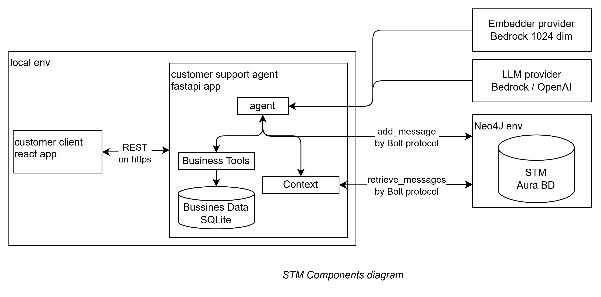

# Agent Memory on Graphs

**A reference architecture for LLM agents that remember — short-term, long-term, reasoning, and procedural memory backed by Neo4j.**

Most "agent memory" implementations are a chat buffer or a vector table. This project treats memory as a first-class part of the software architecture: a graph of conversations, entities, preferences, executions, and distilled skills, with explicit retrieval contracts and provenance for every fact the agent uses.

The running case study is **Acme Cloud**, a fictional SaaS company. A support agent answers billing, plan, and policy questions against a SQLite system of record while Neo4j holds what the agent remembers across turns, sessions, and tasks.

> **Why this matters:** context windows are not memory. Vector-only RAG retrieves text but loses relationships, scope, and history. A graph keeps *who said what, when, about which entity, and what happened next* — the structure an agent needs to act safely.

## Architecture

