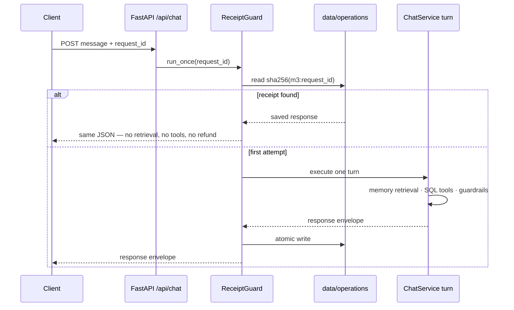
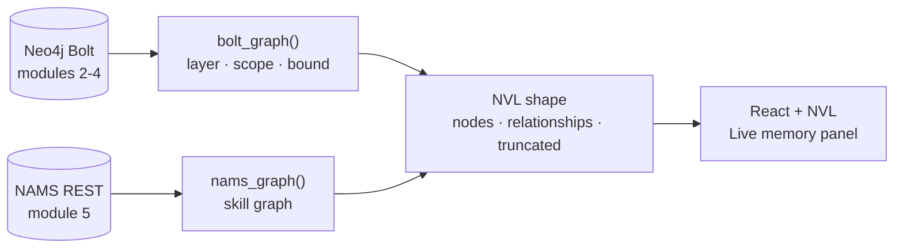

## Reliability: idempotency, receipts, and one response contract

An agent that can move money needs the guarantees of any other transactional
workload. Two shared modules make those guarantees explicit — `lib/operations.py`
and `lib/response.py` — and both are deliberately outside `module_N/`.

### What a receipt is

A **receipt** is the saved record of a completed operation, keyed by the client's
`request_id`. Same idea as the paper receipt in your wallet: if the terminal times
out after charging your card, you show the receipt instead of paying again.

In this backend, `POST /api/chat` writes the exact JSON it returned to
`data/operations/<sha256("m3:request_id")>.json`. A second request with the same ID
reads that file and replays the answer; **the turn never runs again**.

- The filename is a **hash**, so a client-supplied string cannot influence the path.
- The write is **atomic** (temp file + `Path.replace`), so a crash cannot leave half a receipt.
- The key is prefixed per module (`m3:…`), so one `request_id` cannot collide across stages.
- A **failed** turn is recorded too. A retry replays the recorded failure instead of
  silently repeating a side effect; an intentional retry is a new `request_id`.

### Defense in depth

Three independent layers, each catching a different failure:

| Layer | Prevents | Where |
|---|---|---|
| Request receipt | the same request executing twice (timeout, double click, client retry) | `lib/operations.py` |
| Incident uniqueness | a second refund for the same billing case, even with a new `request_id` | `lib/db.py` — `UNIQUE INDEX refunds(incident_id)` |
| Per-turn authorization | a refund the operator did not approve for that message | `prepare_refund` + server-side re-validation |

Idempotency here is a property of the transport and the data, not a prompt
instruction. `GET /api/operations/{request_id}` exposes the receipt so an operator
can inspect an uncertain outcome before deciding to retry.

### One envelope, three states

`lib/response.py` gives every stage the same JSON shape, so the single frontend
never branches on the module. The useful part is that the outcome is not binary:

| `status` | Meaning | Typical cause |
|---|---|---|
| `completed` | turn ran, every memory read and write succeeded | — |
| `degraded` | turn ran, something was lost on the way | retrieval or persistence unavailable |
| `failed` | turn did not complete | model or tool exception |

`degraded` is the state that matters in production: a refund can complete while
semantic recall or the post-answer memory write fails. The reply stays valid,
`business_status` still reports the refund outcome, and the receipt preserves that
evidence for inspection. Collapsing this into success/failure would either hide a
completed payment or discard a valid answer.

Every response also carries `context.evidence` (source IDs and retrieval paths),
`context.used_memory`, timing, warnings, and the SQL each tool actually executed —
which is what turns "the agent remembered" into something a reviewer can verify.

### Why these live in `lib/`

They are transport concerns, not agent behavior. Each `module_N/` stays a complete
snapshot — prompts, tools, memory policy, context assembly — while `lib/` holds only
what must be identical for one frontend and one safety story: the HTTP app, SQLite,
settings, the graph projection (`lib/graph.py`), receipts, and the response
envelope. If `build_response` lived in each `agent.py`, a field added in module 4
would silently break modules 1–3, and the diffs between stages would stop showing
the concept.

Scope of the guarantee, stated honestly: the lock is per process and the receipt
lives on local disk, so the design assumes one backend process per workspace. Two
concurrent backends sharing `data/` would need a database-backed lock or a unique
constraint on `request_id`.

---

## The memory view: one projection, two backends

`lib/graph.py` turns stored memory into the shape the visualization needs. It is a
**read-only projection**: it never writes, extracts, or hydrates. Its only job is to
answer "show me what this agent remembers" for any stage and any backend.

Four filters run on every `GET /api/graph` request:

| Filter | Mechanism | Why |
|---|---|---|
| **Layer** | `layer=short_term`, `long_term` or `reasoning`, mapped to allowed Neo4j labels | show one memory layer at a time |
| **Scope** | optional `session_id`: this conversation, its messages, the entities they mention, and the preferences and traces tied to them | "Live memory of this replay" vs "All stored memory" |
| **Bound** | newest first (`coalesce(timestamp, created_at, started_at)`) plus `LIMIT`, returning `truncated: true` | a memory graph grows forever; the API payload must not |
| **Shape** | induced subgraph: only relationships whose endpoints are both returned | no dangling edges in the viewer |

Two invariants are enforced here instead of trusted to the client:

- **Embeddings never leave the backend.** `_json_value` drops any property whose
  key contains `embedding`, recursively.
- **Driver types never reach the browser.** Neo4j `DateTime` and other driver
  objects are normalized to ISO strings — a plain `json.dumps` would fail on them.

The reason for a single implementation is the same as for the response envelope:
five modules and one frontend, but also **two different stores**. Bolt and the hosted
NAMS backend emit the same `nodes / relationships / truncated` contract, so the
viewer does not need to know which one is feeding it.